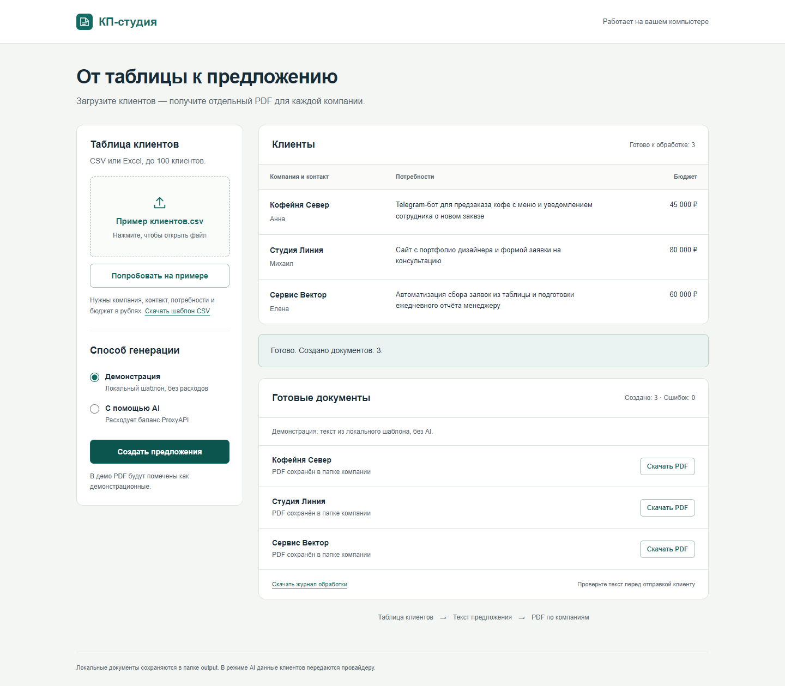

# КП-студия

Делает персональные коммерческие предложения в PDF по таблице клиентов (CSV/Excel): текст пишет модель `openai/gpt-5-mini` через ProxyAPI либо российская модель — GigaChat или YandexGPT (выбор в `.env`), оформление и бюджет — из шаблона.

- **Windows:** `powershell -ExecutionPolicy Bypass -File .\setup.ps1`, затем двойной клик `ОТКРЫТЬ СТУДИЮ.cmd` (или `ДЕМО.cmd` — без AI).
- **macOS / Linux:** `python3 -m venv .venv && .venv/bin/pip install -r requirements.txt && .venv/bin/python -m studio examples/clients.csv --demo`
- Ключ ProxyAPI — в `.env` (образец `.env.example`); без `--demo` идёт реальная генерация, `--limit 1` — один клиент, `--check` — только проверка таблицы.
- Результат: [КП, написанное AI](examples/Образец%20КП%20(AI).pdf), ещё три AI-примера — в [examples/AI-примеры](examples/AI-примеры), таблица на 7 клиентов — [examples/clients.csv](examples/clients.csv).



Материалы: [видеообзор на YouTube](https://youtu.be/D22X12-A25U), [ТЗ в DOCX](docs/Техническое%20задание.docx), [отчёт о проверке](docs/Проверка%20проекта.md). Деморежим помечает документы и не выдаёт шаблон за результат AI.

Проверено 19.10.2026: реальная генерация через `https://api.proxyapi.ru/v1`, модель `openai/gpt-5-mini` — 4 из 4 PDF созданы ([отчёт](docs/demo/live-check.json)). Текст AI перед отправкой клиенту проверяет человек.

## Какой провайдер выбрать

Провайдер задаётся строкой `LLM_PROVIDER` в `.env`: `proxyapi` (по умолчанию), `gigachat` или `yandexgpt`. Промпт, разбор ответа, повторы и журнал одинаковые.

- **ProxyAPI** — российский посредник, но сам текст пишет зарубежная модель (OpenAI и др.). Данные клиента из таблицы уходят за пределы РФ.
- **GigaChat** (Сбер) — обработка в РФ. Нужен «ключ авторизации» из [личного кабинета](https://developers.sber.ru/studio) → `GIGACHAT_CREDENTIALS`, и `GIGACHAT_SCOPE` (`GIGACHAT_API_PERS` для физлиц, `B2B`/`CORP` для юрлиц). Токен живёт около 30 минут; программа кэширует его и обновляет сама. Сертификат GigaChat выдан российским удостоверяющим центром, поэтому в `certs/` лежит публичный корневой сертификат Минцифры (Russian Trusted Root CA).
- **YandexGPT** (Yandex AI Studio) — обработка в РФ. Нужны API-ключ сервисного аккаунта с ролью `ai.languageModels.user` → `YANDEX_API_KEY` и идентификатор каталога → `YANDEX_FOLDER_ID`. Модель по умолчанию `gpt://<каталог>/yandexgpt/latest`.

Российский провайдер снимает вопрос трансграничной передачи, но сам по себе не делает обработку соответствующей 152-ФЗ: уведомление Роскомнадзора, согласия, политика и договор с провайдером — на стороне владельца данных. Это не юридическая консультация.

Проверка: реальная генерация через GigaChat в этой версии ещё не подтверждена (с тестового сервера за пределами РФ API чата не ответил). Работа обоих провайдеров покрыта тестами с подменой HTTP: авторизация, обновление токена, повторы, ошибки, выбор провайдера.

## Подробно: запуск на Windows

Нужен Python 3.12 или новее. В PowerShell:

```powershell
cd 'C:\Projects\kp-studio'
powershell -NoProfile -ExecutionPolicy Bypass -File .\setup.ps1
```

Заполните `.env` по образцу `.env.example`: ключ, адрес API и модель. `.env` исключён из Git и Docker-контекста. В распространяемом архиве и репозитории ключа нет.

После установки запустите `ОТКРЫТЬ СТУДИЮ.cmd` двойным кликом. Откроется локальный экран: выбрать CSV/XLSX → проверить строки → выбрать демонстрацию или AI → создать предложения → скачать PDF и журнал. Пока программа работает, оставьте окно запуска открытым. Закрыть сервер можно сочетанием Ctrl+C в этом окне. Команда запуска вручную:

```powershell
.\.venv\Scripts\python.exe -m studio.web --open
```

Адрес по умолчанию: http://127.0.0.1:8765. Если порт занят, укажите `--port 8766`. Сервер доступен только на этом компьютере. Это локальная утилита, не публичный веб-сервис. Загрузка файла ограничена 5 МБ; одновременно выполняется один браузерный запуск. CLI и web-интерфейс не запускайте на обработку одновременно.

```powershell
# Проверка таблицы без AI
.\.venv\Scripts\python.exe -m studio examples\clients.xlsx --check
# Демонстрация на локальном шаблоне без API и расходов
.\.venv\Scripts\python.exe -m studio examples\clients.xlsx --demo
# Один реальный клиент через API
.\.venv\Scripts\python.exe -m studio examples\clients.xlsx --limit 1
# Вся таблица через API
.\.venv\Scripts\python.exe -m studio examples\clients.xlsx
# Свой файл и папка результатов
.\.venv\Scripts\python.exe -m studio 'C:\данные\клиенты.csv' --output '.\output\мои-кп'
```

Двойной клик по `ДЕМО.cmd` создаёт PDF без AI. `СОЗДАТЬ КП.cmd` обрабатывает все строки `examples/clients.xlsx` через API и расходует баланс провайдера. По умолчанию запуск без `--demo` использует реальный API.

## Запуск на macOS / Linux

```bash
python3 -m venv .venv
.venv/bin/pip install -r requirements.txt
cp .env.example .env   # вписать OPENAI_API_KEY
.venv/bin/python -m studio examples/clients.csv --check
.venv/bin/python -m studio examples/clients.csv --demo
.venv/bin/python -m studio examples/clients.csv --limit 1
.venv/bin/python -m studio.web --open
```

Кириллицу в PDF обеспечивает Arial (macOS) или DejaVu (`fonts-dejavu` в Linux); можно также положить файлы `DejaVuSans.ttf` и `DejaVuSans-Bold.ttf` в папке `assets/`.

## Формат таблицы

Первая строка — заголовки: `Название компании`, `Контактное лицо`, `Потребности клиента`, `Бюджет`. Все четыре поля обязательны. Бюджет — положительное число в рублях, допустимы `45000`, `45 000` и `45000,50`. CSV: UTF-8, разделитель запятая или точка с запятой. Excel: `.xlsx`, первый лист. До 100 строк за запуск. Тестовые компании вымышлены.

Сначала программа проверяет все строки. Некорректные строки попадают в журнал без обращения к AI; корректные обрабатываются последовательно. AI получает данные клиента и пишет содержательную часть предложения. Бюджет выводится из таблицы; программа не выдаёт его за окончательную цену. Условия и следующий шаг берутся из шаблона.

## Результаты

`output/<компания>_<хеш>/КП_<запуск>_строка-N.pdf` — документ с кириллицей. Рядом `.txt` с ответом AI, который сохраняется до создания PDF. Номер строки и уникальный идентификатор запуска предотвращают перезапись. `output/journal.jsonl` — дополняемый журнал результатов (пути к PDF и TXT указаны относительно папки `output`); `batch_*.json` — отчёт каждого запуска. Ошибка одного клиента не останавливает остальные строки. Код завершения 0 означает успех, 1 — ошибку или некорректные строки.

Для ProxyAPI в `.env` можно сменить `OPENAI_BASE_URL` и `OPENAI_MODEL`. Используется совместимый `/chat/completions`, библиотека `openai`. Прямой OpenAI API настраивается адресом `https://api.openai.com/v1` и подходящей моделью. Документация ProxyAPI: https://proxyapi.ru/docs/text-generation

При таймауте, сетевом сбое, HTTP 429 или 5xx программа один раз повторяет запрос через 3 секунды. HTTP 401/402/403 не повторяются. Если ошибка сохраняется, дальнейшие запросы пакета прекращаются: оставшиеся строки журналируются как не отправленные. После восстановления доступа повторите обработку нужных строк. Обычная ошибка отдельного документа не останавливает остальные строки. Для GigaChat и YandexGPT правила те же. Если соединение с ProxyAPI не устанавливается, запустите `tools/check_connection.py`; увеличение таймаута не исправляет недоступный TCP-порт.

## Проверка

```powershell
.\.venv\Scripts\python.exe -m pytest -q --basetemp .tmp\pytest
```

Проверяются бюджеты, CSV/Excel, имена папок, обработка ошибок, повтор запроса при таймауте/429/5xx и отказ без повтора при 401/402, провайдеры GigaChat и YandexGPT (OAuth и кэш токена, формат запросов, ошибки, выбор через `LLM_PROVIDER`) на подменённом HTTP без сети, повторные запуски, журнал, прекращение запросов при недоступном провайдере, HTTP-загрузка файла, генерация и скачивание PDF, защита от запросов посторонних сайтов. Тесты не расходуют API-баланс. Точные версии установленного окружения записаны в requirements.lock.txt; для воспроизводимой установки используйте `pip install -r requirements.lock.txt`. GitHub Actions запускает тесты, демонстрацию и сборку Docker.

Браузерная проверка и запись демонстрации: `node tools/browser_check.cjs` при установленном `playwright` и Chromium. Можно задать `STUDIO_URL` и `STUDIO_BROWSER_PATH`. Скрипт использует только демо и сохраняет скриншоты, WebM-видео и JSON-отчёт в docs/demo/.

## Docker

```powershell
docker compose run --rm studio
docker compose run --rm studio examples/clients.csv --limit 1
```

Первая команда запускает демонстрацию, вторая — реальную генерацию. Для Docker нужен `.env`; результаты доступны в локальной `output/`. Образ содержит DejaVu для кириллицы. Windows использует Arial. Docker требует отдельной проверки на машине с запущенным Docker Engine.

## Ограничения и сдача

Локальная однопользовательская утилита с CLI и браузерным экраном. API платный и зависит от баланса, прав ключа и доступности модели. Клиентские данные передаются провайдеру; в демо используйте только вымышленные данные. PDF и журнал содержат данные клиентов и не должны попадать в публичный репозиторий. Папки output нужно хранить в защищённом месте. AI может допустить фактические ошибки; перед отправкой предложения проверяйте содержание. В output/.uploads сохраняются загруженные таблицы; их можно удалить после завершения работы, когда они больше не нужны.

